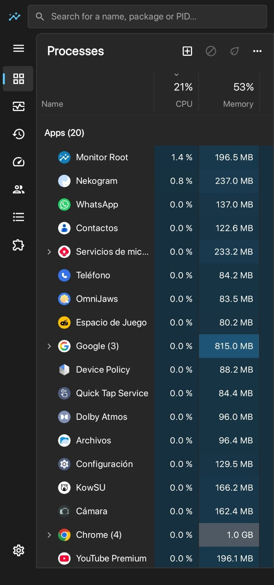
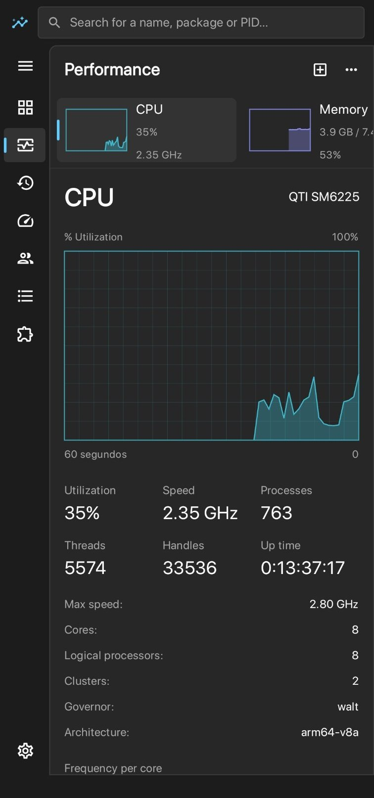
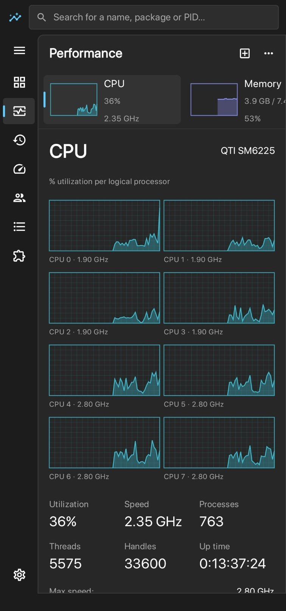
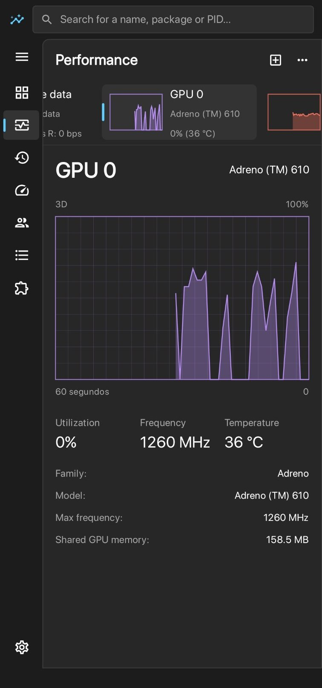
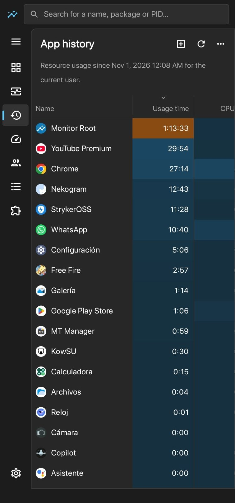

# Monitor Root

[](LICENSE)

Código disponible bajo la [licencia MIT](LICENSE). Copyright (c) 2026 kevxngg.

[English](README.md) | **Español**

**El administrador de tareas para Android con root.** Monitor Root te muestra qué está usando tu teléfono en tiempo real (procesos, CPU, GPU, memoria, disco, red, batería y temperaturas), con el diseño del administrador de tareas de Windows 11.

**[Descargar la última versión (APK)](https://github.com/kevxngg/monitor-root/releases/latest/download/MonitorRoot.apk)** · [Sitio web](https://kevxngg.github.io/monitor-root/es/) · [Todas las versiones](https://github.com/kevxngg/monitor-root/releases)

## Capturas

<table>
  <tr>
    <td align="center"><br><sub>Procesos</sub></td>
    <td align="center"><br><sub>Rendimiento: CPU</sub></td>
    <td align="center"><br><sub>Procesadores lógicos</sub></td>
  </tr>
  <tr>
    <td align="center"><br><sub>Rendimiento: GPU</sub></td>
    <td align="center"><br><sub>Historial de aplicaciones</sub></td>
    <td></td>
  </tr>
</table>

## Funciones

### Procesos
- Apps, procesos en segundo plano y procesos de Android, separados por grupos.
- Uso de CPU, memoria y disco de cada uno, resaltado según cuánto consumen.
- Las apps con varios procesos se pueden expandir para verlos uno por uno.
- **Finalizar tarea** y **modo de eficiencia**, que baja la prioridad de una app y la limita en segundo plano.

### Rendimiento
- Gráficas de los últimos 60 segundos de CPU, memoria, disco, Wi‑Fi, datos móviles, GPU y temperatura.
- CPU: uso general o por procesador lógico, frecuencia de cada núcleo, procesos, subprocesos y tiempo activo.
- Memoria: en uso, disponible, en caché, ZRAM y composición de la memoria.
- GPU: modelo real del chip, uso, frecuencia y temperatura (Adreno, Mali y otros).
- Batería: carga, temperatura, corriente, voltaje, estado y salud, junto con todos los sensores de temperatura.

### Más secciones
- **Historial de aplicaciones:** tiempo de uso, tiempo de CPU y datos de Wi‑Fi y móviles por app.
- **Aplicaciones de arranque:** las apps que se inician con el teléfono, con opción de deshabilitarlas.
- **Usuarios:** consumo por usuario o perfil de trabajo.
- **Detalles:** lista completa por PID con prioridad, afinidad de núcleos, suspender, finalizar árbol de procesos y propiedades.
- **Servicios:** servicios nativos de Android y de las apps, con opciones para iniciarlos, detenerlos y reiniciarlos.
- **Ejecutar nueva tarea:** abre una app por su nombre o ejecuta un comando, con o sin root.

### Herramientas
- **Monitor flotante:** CPU, GPU, RAM, temperaturas y FPS encima de cualquier app, por ejemplo mientras juegas. Se mueve arrastrándolo.
- **Botón de ajustes rápidos** para encender o apagar el monitor flotante.
- **Widget** para la pantalla de inicio con CPU, RAM, temperatura de la CPU y batería.
- **Historial de batería** de las últimas 24 horas, con tiempo restante estimado y velocidad de carga y descarga.
- **Modo de energía** como en Windows 11 (mejor eficiencia energética, equilibrado o mejor rendimiento), que cambia el gobernador de la CPU con root.
- **Ajustes avanzados de CPU y GPU:** gobernador y frecuencia máxima de cada clúster de la CPU, y control de la GPU en cualquier procesador (Qualcomm, MediaTek, Exynos, Tensor, Unisoc).

### Juegos
- **Modo juego:** al abrir uno de tus juegos aplica el modo de energía que elijas, muestra el monitor flotante, puede cerrar apps en segundo plano y activar No molestar. Todo vuelve a la normalidad al salir.
- **Resumen de cada partida:** FPS promedio y bajo, temperatura máxima y batería usada, con una gráfica de FPS que puedes compartir.

### Alertas
- Temperatura alta, una app usando mucha CPU en segundo plano (con botón para finalizarla) y límite de carga para cuidar la batería.

### Configuración
- 11 idiomas: español, inglés, francés, portugués, alemán, italiano, ruso, árabe, chino, japonés y coreano.
- Tema claro, oscuro o según el sistema.
- Página de inicio y velocidad de actualización de los datos.
- Actualizaciones automáticas: aviso dentro de la app y notificación con el botón **Actualizar ahora**. Las consultas usan GitHub; Android puede retrasar las revisiones en segundo plano, por lo que el aviso no es instantáneo.
- Si falla una consulta, la app indica el tipo de error y avisa si hay DNS privado activo que podría estar relacionado. No modifica el DNS del teléfono.
- Las actualizaciones son opcionales. Solo una versión marcada expresamente como obligatoria (con el archivo `MIN_BUILD` de este repositorio) pide a las versiones anteriores que actualicen antes de continuar.

## Requisitos

- Android 8.0 o superior.
- Root permanente con **Magisk**, **KernelSU** o **APatch**, o **root temporal** (el que se activa con una herramienta sin desbloquear el bootloader).
- Procesadores Qualcomm Snapdragon, MediaTek o Exynos.

## Instalación

1. Descarga la APK desde el enlace de arriba.
2. Ábrela y, si Android lo pide, permite instalar apps desconocidas para tu navegador o gestor de archivos.
3. Abre Monitor Root y acepta el aviso de tu gestor de root. Si usas root temporal, actívalo antes de abrir la app.
4. Las siguientes versiones llegarán con un aviso dentro de la app y se instalan con un toque.

## Permisos y privacidad

- **Root:** se usa para leer los procesos y sensores del sistema y para las acciones que tú eliges (finalizar procesos, cambiar prioridades, instalar actualizaciones).
- **Internet:** solo se usa para comprobar si hay una versión nueva en este repositorio de GitHub.
- **Estadísticas de uso:** para el historial de aplicaciones. Los datos se quedan en tu teléfono.
- La app no tiene anuncios ni envía tus datos a ningún servidor.

## Preguntas frecuentes

**¿Funciona sin root?**
No. Desde Android 8, las apps normales no pueden ver los procesos de otras apps ni leer sensores como la carga de la GPU.

**¿Funciona con root temporal?**
Sí. La app funciona igual mientras el root temporal esté activo. Como ese tipo de root se pierde al reiniciar el teléfono, después de cada reinicio tienes que volver a activarlo. Mientras no esté activo, la app no puede leer los datos del sistema ni instalar actualizaciones sola.

**¿Puede dañar mi teléfono?**
Ver información es seguro. Finalizar procesos o servicios del sistema puede hacer que el teléfono se reinicie, por eso la app pide confirmación antes.

**¿Por qué la temperatura de la GPU dice "(SoC)"?**
Algunos procesadores no tienen un sensor propio para la GPU. En ese caso se muestra la temperatura del procesador, que está en el mismo chip.

## Informar un problema

Abre un reporte en [Issues](https://github.com/kevxngg/monitor-root/issues/new). En la app, en **Configuración → Acerca de**, puedes copiar la información de tu dispositivo para incluirla en el reporte.

## Compilar desde el código

El proyecto está hecho en Kotlin con Jetpack Compose.

```bash
git clone https://github.com/kevxngg/monitor-root.git
cd monitor-root
gradle assembleRelease
```

La APK queda en `app/build/outputs/apk/release/`.

## Autor

Hecho por **[kevxngg](https://github.com/kevxngg)**.

- [GitHub](https://github.com/kevxngg)
- [Instagram](https://www.instagram.com/kevxngg)
- [Facebook](https://www.facebook.com/kevxngg)
- [LinkedIn](https://www.linkedin.com/in/kevxngg)
- [TikTok](https://www.tiktok.com/@kevxngg)
- [Telegram](https://t.me/kevxngg)
- Discord: `kevxngg`

Monitor Root no está afiliado a Microsoft. Windows es una marca de Microsoft Corporation.
