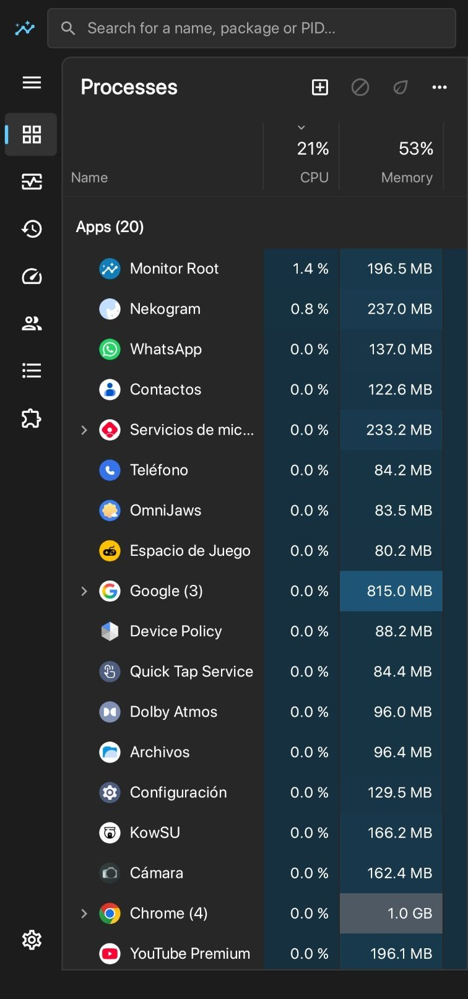
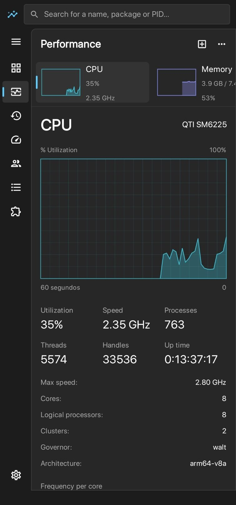
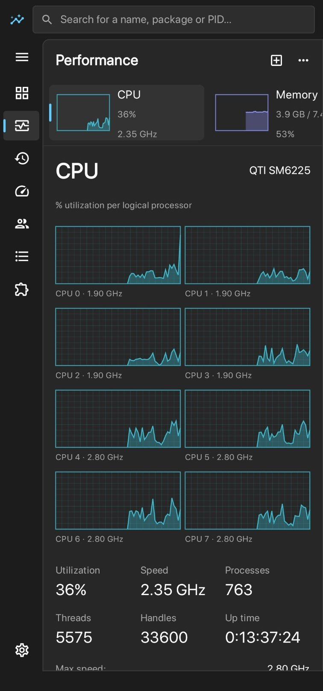
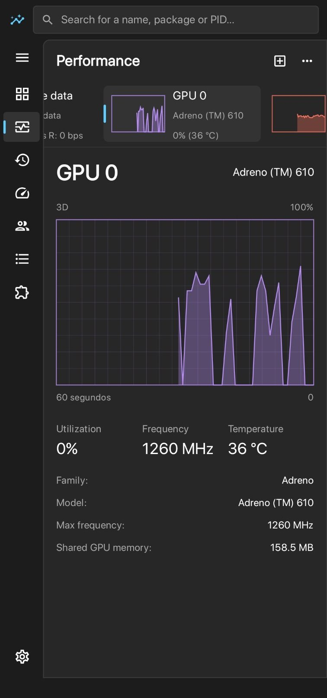
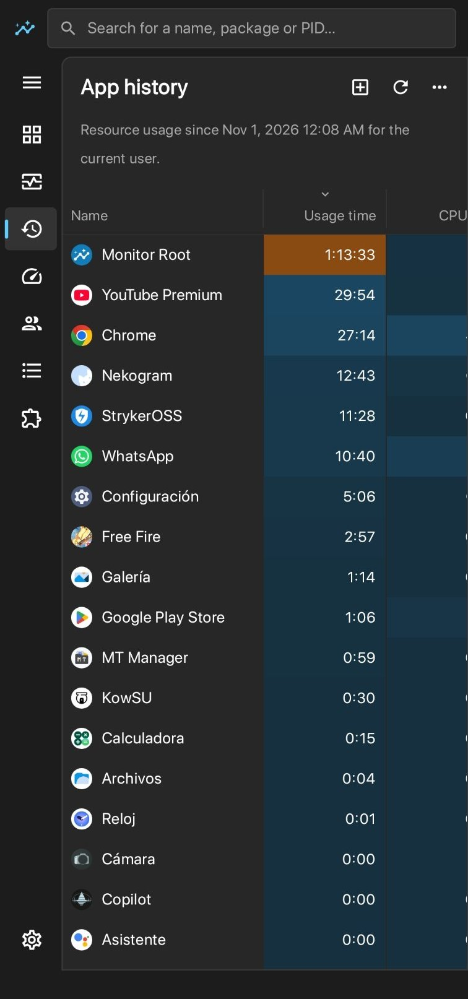

# Monitor Root

**English** | [Español](README.es.md)

**The task manager for rooted Android.** Monitor Root shows what your phone is using in real time (processes, CPU, GPU, memory, disk, network, battery and temperatures), with the look of the Windows 11 Task Manager.

**[Download the latest version (APK)](https://github.com/kevxngg/monitor-root/releases/latest/download/MonitorRoot.apk)** · [Website](https://kevxngg.github.io/monitor-root/) · [All releases](https://github.com/kevxngg/monitor-root/releases)

## Screenshots

<table>
  <tr>
    <td align="center"><br><sub>Processes</sub></td>
    <td align="center"><br><sub>Performance: CPU</sub></td>
    <td align="center"><br><sub>Logical processors</sub></td>
  </tr>
  <tr>
    <td align="center"><br><sub>Performance: GPU</sub></td>
    <td align="center"><br><sub>App history</sub></td>
    <td></td>
  </tr>
</table>

## Features

### Processes
- Apps, background processes and Android processes, split into groups.
- CPU, memory and disk usage for each one, highlighted by how much they use.
- Apps with several processes can be expanded to see each one.
- **End task** and **efficiency mode**, which lowers an app's priority and limits it in the background.

### Performance
- 60-second graphs for CPU, memory, disk, Wi‑Fi, mobile data, GPU and temperature.
- CPU: overall or per logical processor, frequency of each core, processes, threads and up time.
- Memory: in use, available, cached, ZRAM and memory composition.
- GPU: real chip model, utilization, frequency and temperature (Adreno, Mali and others).
- Battery: charge, temperature, current, voltage, status and health, plus every temperature sensor.

### More sections
- **App history:** usage time, CPU time, and Wi‑Fi and mobile data per app.
- **Startup apps:** apps that start with the phone, with an option to disable them.
- **Users:** usage per user or work profile.
- **Details:** full list by PID with priority, core affinity, suspend, end process tree and properties.
- **Services:** native Android and app services, with options to start, stop and restart them.
- **Run new task:** open an app by name or run a command, with or without root.

### Settings
- 11 languages: English, Spanish, French, Portuguese, German, Italian, Russian, Arabic, Chinese, Japanese and Korean.
- Light, dark or system theme.
- Start page and data refresh speed.
- Automatic updates: in-app prompt and a notification with an **Update now** button.

## Requirements

- Android 8.0 or later.
- Permanent root with **Magisk**, **KernelSU** or **APatch**, or **temporary root** (enabled with a tool, without unlocking the bootloader).
- Qualcomm Snapdragon, MediaTek or Exynos processors.

## Installation

1. Download the APK from the link above.
2. Open it and, if Android asks, allow your browser or file manager to install unknown apps.
3. Open Monitor Root and accept your root manager's prompt. If you use temporary root, enable it before opening the app.
4. Future versions arrive with an in-app prompt and install with one tap.

## Permissions and privacy

- **Root:** used to read system processes and sensors, and for the actions you choose (ending processes, changing priorities, installing updates).
- **Internet:** only used to check this GitHub repository for a new version.
- **Usage statistics:** for app history. The data stays on your phone.
- The app has no ads and doesn't send your data to any server.

## FAQ

**Does it work without root?**
No. Since Android 8, regular apps can't see other apps' processes or read sensors like GPU load.

**Does it work with temporary root?**
Yes. The app works the same while temporary root is active. Because that kind of root is lost when the phone restarts, you need to enable it again after every restart. Until it's active, the app can't read system data or install updates on its own.

**Can it damage my phone?**
Viewing information is safe. Ending system processes or services can restart the phone, so the app asks for confirmation first.

**Why does the GPU temperature say "(SoC)"?**
Some processors don't have their own GPU sensor. In that case the app shows the processor temperature, which is on the same chip.

## Report a problem

Open a report in [Issues](https://github.com/kevxngg/monitor-root/issues/new). In the app, under **Settings → About**, you can copy your device information to include it in the report.

## Build from source

The project is written in Kotlin with Jetpack Compose.

```bash
git clone https://github.com/kevxngg/monitor-root.git
cd monitor-root
gradle assembleRelease
```

The APK ends up in `app/build/outputs/apk/release/`.

## Author

Made by **[kevxngg](https://github.com/kevxngg)**.

- [GitHub](https://github.com/kevxngg)
- [Instagram](https://www.instagram.com/kevxngg)
- [Facebook](https://www.facebook.com/kevxngg)
- [LinkedIn](https://www.linkedin.com/in/kevxngg)
- [TikTok](https://www.tiktok.com/@kevxngg)
- [Telegram](https://t.me/kevxngg)
- Discord: `kevxngg`

Monitor Root is not affiliated with Microsoft. Windows is a trademark of Microsoft Corporation.
