# Monitor Root

[](LICENSE)

Source code is available under the [MIT license](LICENSE). Copyright (c) 2026 kevxngg.

**The task manager for Android, with root or Shizuku.** Monitor Root shows what your phone is using in real time (processes, CPU, GPU, memory, disk, network, battery and temperatures), with the look of the Windows 11 Task Manager or the macOS Activity Monitor.

**[Download the latest version (APK)](https://github.com/kevxngg/monitor-root/releases/latest/download/MonitorRoot.apk)** · [Website](https://kevxngg.github.io/monitor-root/) · [All releases](https://github.com/kevxngg/monitor-root/releases)

## Screenshots

All screenshots were taken on a Redmi Note 14 Pro 4G (MediaTek Helio G99) with root.

### Windows 11 style (Task Manager)

<table>
  <tr>
    <td align="center">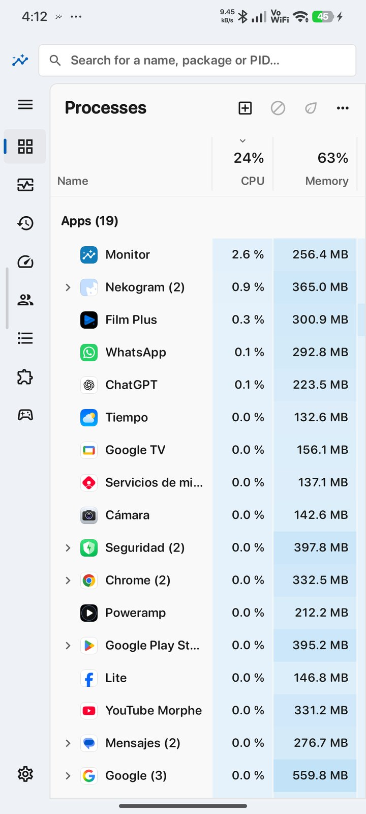<br><sub>Processes</sub></td>
    <td align="center">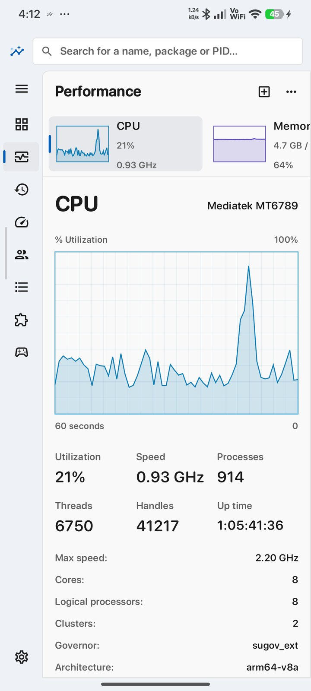<br><sub>Performance: CPU</sub></td>
    <td align="center">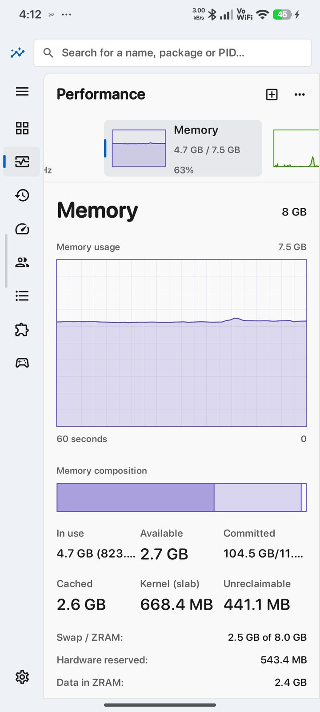<br><sub>Performance: Memory</sub></td>
    <td align="center">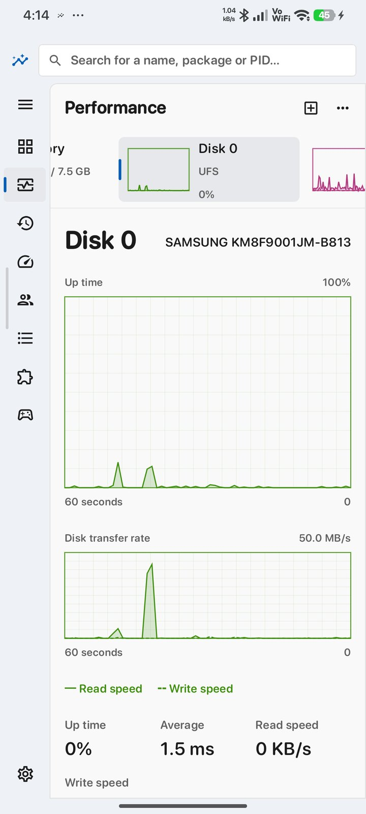<br><sub>Performance: Disk</sub></td>
  </tr>
  <tr>
    <td align="center">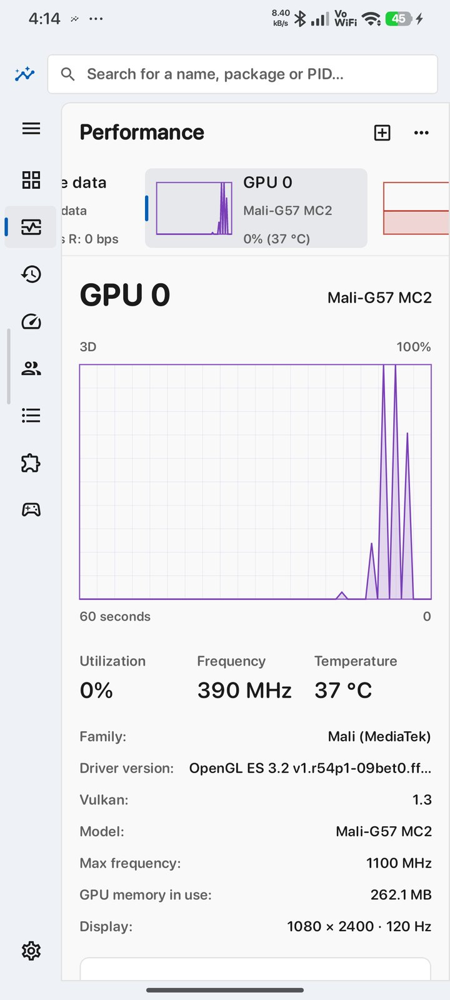<br><sub>Performance: GPU</sub></td>
    <td align="center">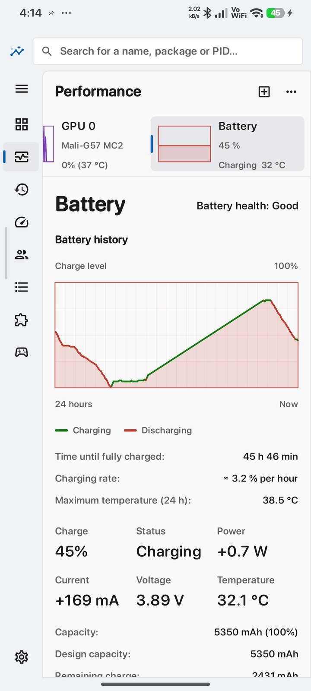<br><sub>Performance: Battery</sub></td>
    <td align="center">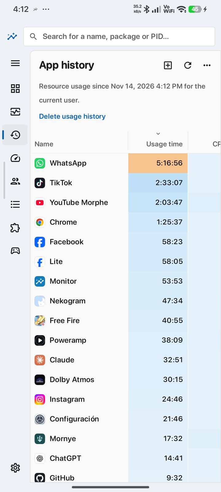<br><sub>App history</sub></td>
    <td align="center">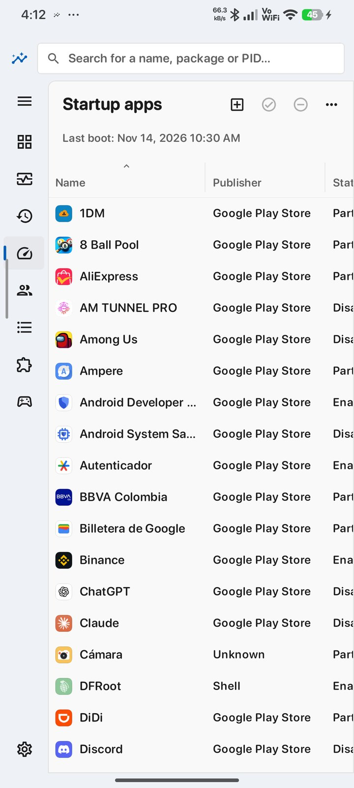<br><sub>Startup apps</sub></td>
  </tr>
  <tr>
    <td align="center">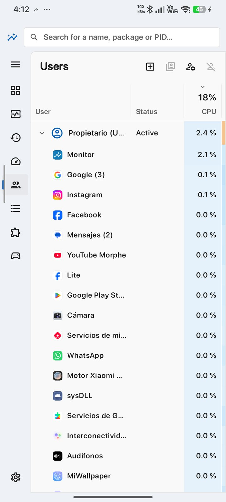<br><sub>Users</sub></td>
    <td align="center">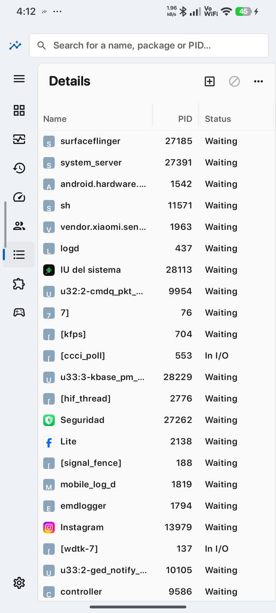<br><sub>Details</sub></td>
    <td align="center">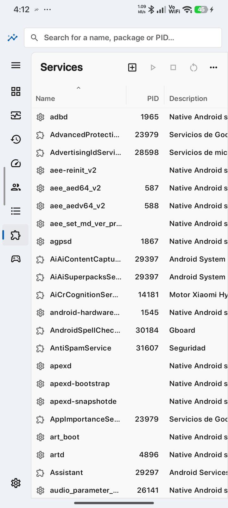<br><sub>Services</sub></td>
    <td align="center">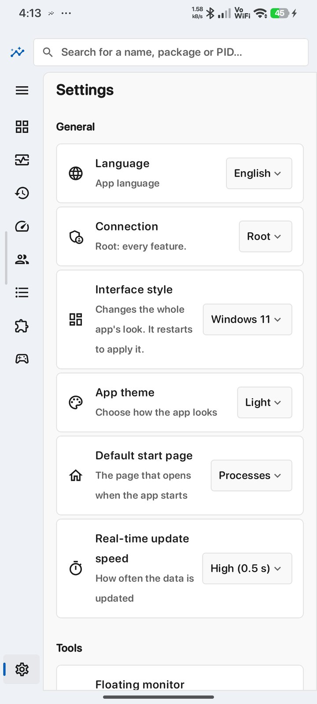<br><sub>Settings</sub></td>
  </tr>
</table>

### Game mode

<table>
  <tr>
    <td align="center">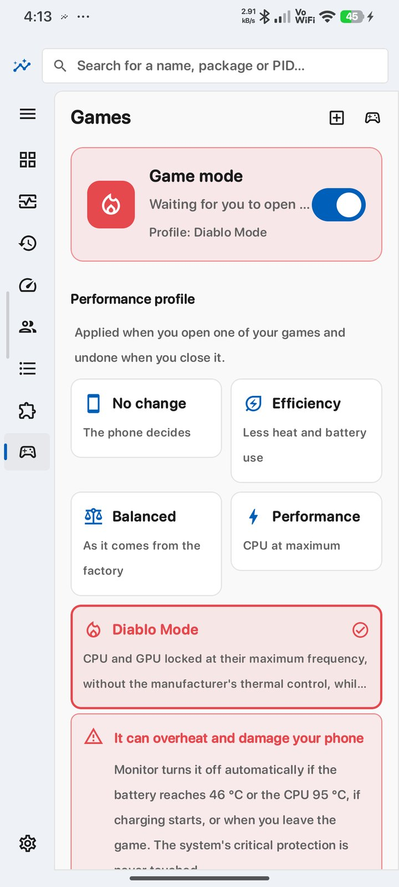<br><sub>Game mode and performance profiles</sub></td>
    <td align="center">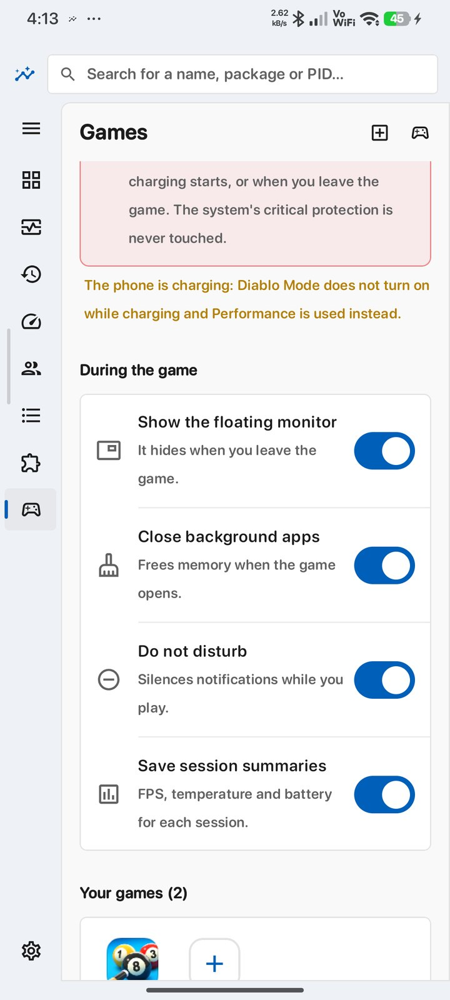<br><sub>Options during the game</sub></td>
  </tr>
</table>

### macOS style (Activity Monitor)

<table>
  <tr>
    <td align="center">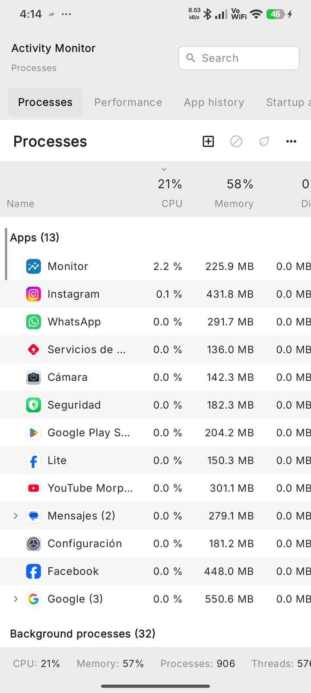<br><sub>macOS style: Processes</sub></td>
    <td align="center">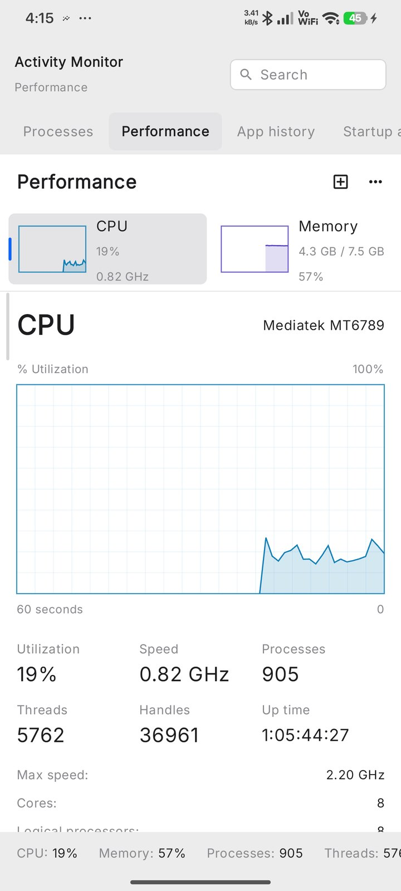<br><sub>macOS style: Performance</sub></td>
  </tr>
</table>

## Features

### Processes
- Apps, background processes and Android processes, split into groups.
- CPU, memory and disk usage for each one, highlighted by how much they use.
- Apps with several processes can be expanded to see each one.
- **End task** and **efficiency mode**, which lowers an app's priority and limits it in the background.

### Performance
- 60-second graphs for CPU, memory, disk, Wi‑Fi, mobile data, GPU and temperature.
- CPU: overall or per logical processor, frequency of each core, processes, threads, up time, temperature, load average, core types and caches.
- Memory: in use, available, cached, free, active and inactive, ZRAM with its compression ratio, and memory composition.
- Disk: active time, read and write speed, response time, capacity, used space, file system and data read and written since boot.
- Wi‑Fi: speed, signal strength and quality, standard, band and channel, link speed and addresses.
- Mobile data: speed, carrier, network type (4G, 5G, Wi‑Fi calling) and roaming.
- GPU: real chip model, utilization, frequency, temperature, driver and Vulkan version, memory in use, and the screen resolution and refresh rate (Adreno, Mali and others).
- Battery: charge, power, current, voltage, temperature, status and health; real and design capacity, remaining charge in mAh, charge cycles, technology and charge type; plus every temperature sensor.

### More sections
- **App history:** usage time, CPU time, and Wi‑Fi and mobile data per app.
- **Startup apps:** apps that start with the phone, with an option to disable them.
- **Users:** usage per user or work profile.
- **Details:** full list by PID with priority, core affinity, suspend, end process tree and properties.
- **Services:** native Android and app services, with options to start, stop and restart them.
- **Run new task:** open an app by name or run a command, with or without root.

### Tools
- **Floating monitor:** a panel on top of any app with CPU, GPU, RAM and temperature gauges, graphs, network, storage and FPS. Four designs (full, compact, gamer and retro), resizable by dragging its corner, adjustable transparency, and it minimizes to a bubble with the app logo that sticks to the screen edge.
- **Quick Settings button** to turn the floating monitor on or off.
- **Home screen widget** with CPU, RAM, CPU temperature and battery.
- **Battery history** for the last 24 hours, with estimated time remaining and charge and discharge rates (% per hour), shown from the first moment.
- **Power mode** like Windows 11 (best power efficiency, balanced or best performance), which switches the CPU governor with root.
- **Advanced CPU and GPU settings:** governor and maximum frequency per CPU cluster, and GPU control on any processor (Qualcomm, MediaTek, Exynos, Tensor, Unisoc).

### Games
- **Game mode:** when one of your games opens, it applies the performance profile you choose, shows the floating monitor, can close background apps and turn on Do not disturb. Everything goes back when you leave.
- **Performance profiles:** no change, efficiency, balanced, performance or Diablo Mode. Changing the profile while a game is open applies right away.
- **Diablo Mode** (root only): locks the CPU and GPU at their maximum frequency and removes the limits that slow them down with heat while the game is open. It warns you first, never touches the kernel's critical thermal protection, and turns itself off if the battery reaches 46 °C, the CPU reaches 95 °C or you leave the game. It also works while charging; use the original charger so the phone gets all the power it needs.
- **Session summary:** average and low FPS, max temperature and battery used for each session, with an FPS graph you can share.

### Alerts
- High battery temperature, an app using a lot of CPU in the background (with a button to end it), and a charge limit to protect the battery.

### Settings
- 11 languages: English, Spanish, French, Portuguese, German, Italian, Russian, Arabic, Chinese, Japanese and Korean.
- Two interface styles: **Windows 11** (Task Manager) or **macOS** (Activity Monitor).
- Light, dark, system or **pure black** theme for AMOLED screens.
- Connection: **root** or **Shizuku**, changeable at any time.
- Start page and data refresh speed.
- Automatic updates: in-app prompt and a notification with an **Update now** button. Checks use GitHub; Android may delay background checks, so notifications are not instantaneous.
- Failed checks show the type of error and indicate when active private DNS may be related. The app does not change the phone’s DNS.
- Updates are optional. Only a release explicitly marked as required (with the `MIN_BUILD` file in this repository) asks older versions to update before continuing.


## Requirements

- Android 8.0 or later.
- **Root** (Magisk, KernelSU, APatch or temporary root) for every feature, **or [Shizuku](https://shizuku.rikka.app/)** to use it without root.
- Qualcomm Snapdragon, MediaTek or Exynos processors.

## Installation

1. Download the APK from the link above.
2. Open it and, if Android asks, allow your browser or file manager to install unknown apps.
3. Open Monitor and choose **Connect with root** (accept your root manager's prompt) or **Connect with Shizuku** (start Shizuku first and accept its permission).
4. Future versions arrive with an in-app prompt and install with one tap.

## Permissions and privacy

- **Root or Shizuku:** used to read system processes and sensors, and for the actions you choose (ending processes, changing priorities, installing updates).
- **Internet:** only used to check this GitHub repository for a new version.
- **Usage statistics:** for app history. The data stays on your phone.
- The app has no ads and doesn't send your data to any server.

## FAQ

**Does it work without root?**
Yes, with [Shizuku](https://shizuku.rikka.app/). Monitor reads processes, CPU, memory, network, storage, battery, temperatures and FPS, and can close apps. Anything that changes the system (power mode, CPU and GPU settings, process priority) and a few readings Android blocks (GPU usage and disk activity) still need root, and the app marks them **Root only**.

**Does it work with temporary root?**
Yes. The app works the same while temporary root is active. Because that kind of root is lost when the phone restarts, you need to enable it again after every restart. Until it's active, the app can't read system data or install updates on its own.

**Can it damage my phone?**
Viewing information is safe. Ending system processes or services can restart the phone, so the app asks for confirmation first.

**Why does the GPU temperature say "(SoC)"?**
Some processors don't have their own GPU sensor. In that case the app shows the processor temperature, which is on the same chip.

## Report a problem

Open a report in [Issues](https://github.com/kevxngg/monitor-root/issues/new). In the app, under **Settings → About**, you can copy your device information to include it in the report.

## Build from source

The project is written in Kotlin with Jetpack Compose.

```bash
git clone https://github.com/kevxngg/monitor-root.git
cd monitor-root
gradle assembleRelease
```

The APK ends up in `app/build/outputs/apk/release/`.

## Author

Made by **[kevxngg](https://github.com/kevxngg)**.

- [GitHub](https://github.com/kevxngg)
- [Instagram](https://www.instagram.com/kevxngg)
- [Facebook](https://www.facebook.com/kevxngg)
- [LinkedIn](https://www.linkedin.com/in/kevxngg)
- [TikTok](https://www.tiktok.com/@kevxngg)
- [Telegram](https://t.me/kevxngg)
- Discord: `kevxngg`

Monitor Root is not affiliated with Microsoft or Apple. Windows is a trademark of Microsoft Corporation; macOS is a trademark of Apple Inc.
